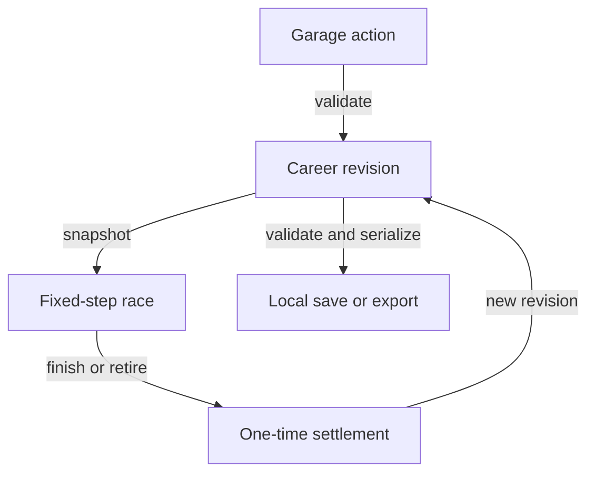

# STREET-RACER architecture

STREET-RACER is an unbundled static browser application. Original HTML, CSS,
JavaScript modules and Canvas2D drawing make the interface and game. Small
vendored components provide the clock, gamepad reader and parts of the audio
system. There is no account service, remote game-state API or runtime asset CDN.

This document describes the implemented contracts. Executed results belong in
[VALIDATION.md](VALIDATION.md); the distinction matters when a browser, device or
performance workload has not been exercised.

## File boundaries

| File or directory | Responsibility |
| --- | --- |
| `index.html`, `style.css` | Accessible document shell, responsive presentation and native controls. |
| `js/catalog.js` | Original vehicle, part, rival, course and paint definitions. |
| `js/core.js` | Career validation, economy transitions, fixed-step driving and result settlement. |
| `js/ui.js` | DOM-free markup builders; escape save-derived strings before inserting markup. |
| `js/app.js` | Browser input, views, dialogs, frame scheduling, persistence and subsystem coordination. |
| `js/render.js` | Original car, garage and road drawing; reads simulation state without changing it. |
| `js/audio.js` | Original arrangement, bounded Web Audio voices and telemetry-driven engine/tyre sound. |
| `js/arcade.js` | Stake-free arcade side events: five fixed-step vehicle modes, contact, goals, gaps and objectives. |
| `js/arcade-geometry.js` | Original low-poly course and vehicle triangles for the WebGL modes; reads world state only. |
| `js/arcade-render.js` | Pseudo-3D highway raster and the WebGL follow camera; never advances the world. |
| `vendor/` | Unmodified pinned source/licence files and the provenance manifest. |
| `scripts/site.mjs`, `sw.js` | Public inventory, static staging and the generated offline worker. |
| `tests/` | Pure module regressions and the packaged browser scenario suite. |

## Career ownership and race transactions

The app owns one career object. It includes integer cash, reputation, the day,
up to four cars, installed part levels, the active car, rival progress, records
and the most recent twenty journal entries. Cars have independent identities;
owning two examples of the same catalogue model does not alias their upgrades
or resources.

`applyAction(career, action)` validates and copies the source, checks the action's
requirements and returns `{ok, state, message}`. Rejected purchases or upgrades
return the original state. A successful transition increments the career revision
and appends a bounded journal entry. The app adopts that returned state and then
attempts to save it. Browser storage failure does not discard the in-memory career.

`startRace` admits the selected car, rival, course, stake and transmission, then
creates a separate race snapshot. It does not debit the career or mutate the
garage. During driving, only that race snapshot changes. Restarting a current
attempt creates another snapshot from the same unchanged career, so it neither
accumulates charges nor repairs an already settled result.

`settleRace` requires a finished race, the originating career revision, the
expected race identity and the original owned car. It rejects duplicate, stale
or already settled results. A settlement stores its identity in the career so
save/reload cannot accidentally pay that result a second time. Cash challenges
apply the agreed wager and applicable purse; pink slips transfer or remove a
car. Capacity for a potential prize identity and bay is checked before admission.

Practice uses a temporary full-condition car and tank. Settlement changes no
car resources, cash, reputation, win/loss totals or best-time records. It records
an attempt without turning a practice victory into campaign progress.

This is a local single-player integrity contract. It prevents ordinary double
clicks, stale callbacks and repeated settlement from changing the economy twice.
The owner can edit their browser or exported JSON; neither a signature nor an
online anti-cheat system is claimed.

## Deterministic driving and bounded time

The simulation step is **1/60 second**. Distances are metres, speeds are metres
per second, and the interface converts speed to km/h. The catalogue's top speeds
are in km/h. Countdown time is separate from timed driving.

The app uses the source-pinned VANILLAJS `FixedClock` with:

- `step: 1/60`;
- `maxFrame: 0.1` seconds;
- `maxSteps: 6` per presentation frame;
- `snapTolerance: 0.0005` seconds, with the donor clock's drift repayment.

Long stalls therefore do not create an unlimited catch-up loop. Excess time can
be dropped by the clock; a slow browser may run the simulation more slowly than
wall time. Pausing clears accumulated time, and resuming resets the presentation
timestamp so time spent away does not turn into extra race steps.

The core also exposes a bounded accumulator for independent callers. `stepRace`
accepts finite frame durations from zero through 0.25 seconds and consumes fixed
ticks. The app passes the clock's exact fixed step into it. Shift edges are queued
until a simulation tick consumes them; a held shift input does not jump several gears.

Race hazards, drag-strip crosswind gusts, each driver's torque-steer direction
and every traffic vehicle derive from the career seed, attempt number and course
through the pinned VANILLAJS `seededRandom` generator, drawn once in `startRace`;
no tick draws from it. Road curvature is a pure function of course and distance.
Neither rendering nor audio calls the simulation RNG. Repeating the same initial state and tick inputs in the
tested runtime reproduces the state. Floating-point operations and trigonometric
functions are used: this is not a cross-engine bit-exactness or formal-proof claim.

The arcade model includes acceleration, braking, grip, gear ratios, shift delay,
condition-dependent power, fuel, sustained redline damage, off-road and strip-wall
losses, roadside hazards, lane-overlap contact between the two racers and with
oncoming or same-direction traffic (one-dimensional swept detection with a
stylised response), and a deterministic rival that holds a lane, merges, passes
or brakes around the same traffic, with a per-course time limit. Finish-line crossing is
interpolated within the last step to
resolve two cars crossing in one tick. It is not a certified real-vehicle dynamics
or engine model; the displayed build estimate is not a real-world performance promise.

## Rendering and responsive input

The renderer reads the race snapshot and paints original vector-like Canvas2D
artwork. It does not advance time or change the race. Menu painting is scheduled
on demand; the race presentation is capped near 60 paints per second independently
of the simulation clock.

`prepareCanvas` reads CSS dimensions, clamps device-pixel ratio to **1–2**, and
rounds backing dimensions. It writes `canvas.width` or `canvas.height` only when
that backing dimension actually changes. The transform uses the rounded backing
size divided by CSS size, preserving alignment at fractional pixel ratios.
There is no full-scene raster cache or claimed measured GPU speedup.

If Canvas2D cannot be obtained, drawing reports failure without throwing. The DOM
retains the garage's text, purchase controls and the race instruments/pause control.
That fallback does not make road scenery observable without a working canvas.

Keyboard keys, touch pointers and standard gamepad controls feed one normalized
input sample. The GAMES reader supplies deadzones, button edges and neutral
rearming. Digital steering from keys or touch ramps in over about 0.14 s and
releases in 0.07 s before it reaches the simulation; analog stick values bypass
the ramp. Pause, blur, page hide, visibility loss, restarting and leaving a race
release held inputs. The game does not resume an interrupted race until the driver
explicitly resumes. Text fields and open dialogs guard driving shortcuts.

Native buttons, labels, dialogs and forms provide the interaction surface around
the canvas. High contrast is an explicit preference. Reduced motion follows the
operating system preference; it is a presentation setting and does not alter race
outcomes.

## Arcade side events

The arcade is a second, independent runtime beside the career race. `beginArcade`
builds its own screen, world and `FixedClock` (`step` 1/60, `maxFrame` 0.1,
`maxSteps` 8) and marks the shell inert; a career race and a side event can never
run together. The world advances only through `stepArcade(world, input, dt)` with
the clock's exact step, and every tick's input is appended to a bounded replay
list that the player can download as JSON. The modes, objectives, contact rules,
ball physics and elevated-course heights are owned by `js/arcade.js`; they adapt
VANILLAJS pull request #83 but are not shared engine code.

The only career fact a side event reads is the active car's paint. It never calls
`applyAction`, `settleRace` or the save path, so the career revision, cash, cars
and records are byte-identical before and after a run; the browser suite asserts
this. Pause, resume, restart, focus loss, controller loss, fullscreen and the
shared sound button reuse the race screen's handlers and presentation classes.

The pseudo-3D highway draws with the same `prepareCanvas` contract as the career
renderer. The 3D modes create a pinned VANILLAJS `Renderer` on a fresh canvas per
run and release the GPU context on exit through `WEBGL_lose_context`. A lost
context pauses the run and reports it; an unavailable WebGL leaves the
instruments, pause and exit controls in place. Engine and tyre sound come from the
career audio receiver fed by `arcadeTelemetry`, a bounded speed-to-rpm mapping.

## Audio lifecycle and resource bounds

Audio is disabled initially and creates a Web Audio context only after explicit
activation. The app's presentation frame calls `audio.update`; there is no
independent music timer that accumulates callbacks while a tab is suspended.

The arrangement uses a seeded 64-step phrase built from the pinned E8_MUSIC root
projection and traversal, with authored pitch quantization, harmony, rhythm and
mixing. SONIFICATION's separate music-first `APP/` instrument produces the plucked
notes. ARCADE supplies seeded noise for percussion and tyres. These choices are
artistic mappings, not physical or canonical ETQ-101 sound claims.

The audio layer bounds its live resources to **24 transient voices, three reused
continuous sources and 64 synthesized note buffers**. A shared half-second noise
buffer supplies percussion and tyres. It skips missed music beats after a stall
instead of playing an unlimited burst. Muting zeros the master, stops transient
voices and suspends the context; disposal disconnects and closes it. Source
creation, mutation and buffer limits have separate regression coverage.

See [PROVENANCE.md](PROVENANCE.md) for exact source commits, hashes, licences and
the distinction between SONIFICATION's music laboratory and its research exports.

## Persistence and admission

The career, preferences and quarantined unreadable save use separate
`street-racer.*.v1` local-storage keys. The app attempts persistence after successful
career actions and settlement. If storage is unavailable, it preserves the live
career, warns the player and supports a normal JSON export.

The save envelope identifies `street-racer` and version 1. Imports are bounded to
**64 KiB of UTF-8** before JSON admission. Core validation checks finite bounded
numbers, integer money, known model and rival identities, installed part ranges,
unique car identities, garage capacity, bounded journal text and championship
consistency. Prototype-related own properties are rejected. Normalization copies
only supported state fields.

An imported career is previewed before explicit replacement. Asynchronous file
reads carry the dialog generation that began them, so a stale read cannot replace
a newer modal or race flow. Unreadable local save bytes are quarantined and remain
available through the recovery download after later reloads. Import errors do not
replace the current career.

Races in progress are not serialized. A page reload restores the last garage
save, not a partial racing snapshot. Saves are portable data, not executable mods.

## Offline packaging and updates

`scripts/site.mjs` inventories explicit public roots: the document, stylesheet,
web manifest, root licence, game modules, artwork and vendor tree. It rejects
symlinks, checks local module imports and hashes file names plus contents. `refresh`
writes `sw.js`; `check` rejects a stale generated worker; `build _site` copies only
the public inventory, worker and `.nojekyll` into a clean staging directory.

The generated worker uses a content-derived `street-racer-…` cache name. Installation
pre-caches the complete inventory. Activation removes only earlier caches with
that application prefix and claims its clients; other applications' caches are
left alone. Fetch handling is confined to same-origin GETs inside the registered
scope. Navigations try the network and fall back to the cached index; inventoried
game resources use the named cache. No runtime request is made to donor repositories.

Offline availability requires a successful initial installation on a suitable
served origin. Browser cache eviction, disabled service workers or unavailable
storage remain browser conditions, so an export is still the durable player-owned
career backup.

## Delivery and evidence

The workflow verifies pull requests and every push to `main`. It runs module tests,
provenance and inventory checks, stages the site and exercises it using isolated,
pinned Playwright tooling. Browser evidence is uploaded even when a check fails.
This development tooling is not included in the game package.

The Pages deploy job depends on verification and runs for `main`; the repository
must select GitHub Actions as its Pages source. A PR is reviewable source, not an
assertion that a release or live deployment already exists.

No formal proof, universal optimization speedup, subjective listening assessment
or untested device/browser coverage follows from these contracts. The
[validation report](VALIDATION.md) records what was actually executed and where
the practical limits remain.
